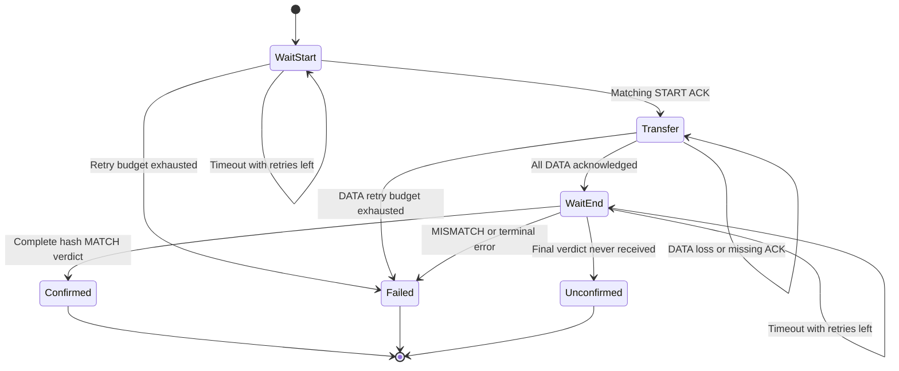
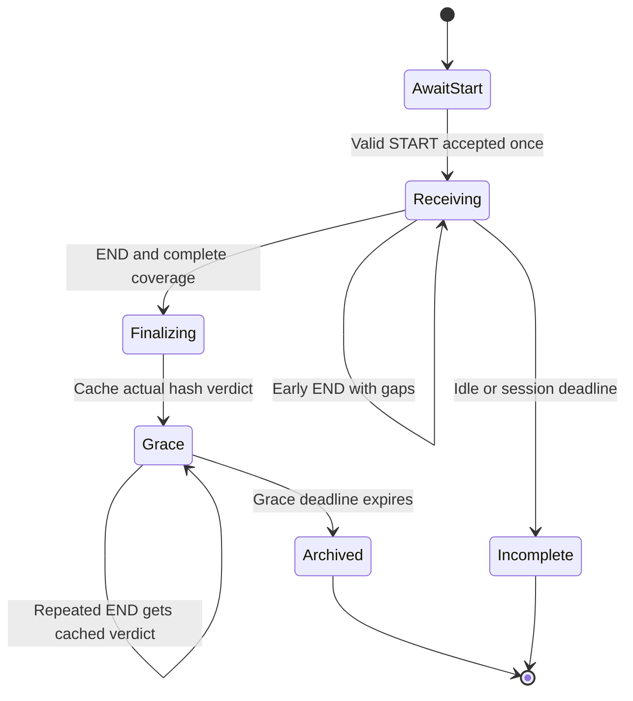

# Stage 4 — Architecture and Packet Lifecycle

**Status:** Design proposal for student review; no implementation authorized.  
**Date:** 16 November 2026.  
**Scope:** Compare two small architectures and reason through startup, data transfer and shutdown, including loss of START, DATA, ACK and END.

This is a design worksheet and decision aid. It is not a report section to submit. The student still chooses the architecture and ARQ scheme, writes the implementation and explains the decisions in their own report.

Requirement IDs refer to [the supplied assignment inventory](../references/assignment-requirements.md). **[Assignment]** marks source requirements; **[Proposal]** marks choices made here for discussion; **[Open]** marks unresolved decisions. Nothing labeled proposal is a new professor requirement.

## 1. What this design must explain

| Obligation | Source | Design question |
| --- | --- | --- |
| TCP framing, partial reads and final hash verdict | R-TCP-02–07 [PDF p.2] | How do endpoints know the complete file arrived? |
| UDP packet header, byte order and START/END | R-UDP-02–04 [PDF p.3] | How do both endpoints agree which transfer and message they are handling? |
| Mechanisms individually switchable | R-UDP-01 [PDF p.3] | How are naive, reliable and reordering modes kept distinguishable? |
| One justified ARQ scheme, corruption and duplicate handling, bounded retries | R-B3-01–06 [PDF p.4] | What happens when data or a receipt disappears? |
| Incorrect and correct reassembly under reordering | R-B4-01–04 [PDF p.4] | Can both reconstructions be compared using the same arrival trace? |
| File hashes, raw run metrics and clean failures | R-HASH-01–06; R-EXP-05; R-CODE-06 [PDF pp.5–6, 8] | How do we preserve success, failure and uncertainty honestly? |

## 2. Architecture: two reasonable options

| Option | Conceptual organization | Advantage | Cost |
| --- | --- | --- | --- |
| A. Minimal standalone programs | Separate TCP and UDP client/server programs; each contains its own parsing, hashing and logging | Fewer files and easy first navigation | Duplicate parsing/statistics; fixes may diverge between endpoints |
| B. Small shared core | Thin TCP/UDP entry points, with shared packet validation, file hashing and run-record definitions | One definition of the wire format and counters; clearer comparison | Requires a few explicit module boundaries |

**[Proposal] Recommend B**, with a very small shared core and one transfer at a time. No framework, plug-in system, GUI or concurrency layer is needed for this proposal.

**Prospective responsibilities only — none of these source directories/files is being created now:**

| Area | Owns | Must not silently decide |
| --- | --- | --- |
| TCP client/server | Connection, framed metadata, streamed bytes, final verdict | UDP counters or retransmission policy |
| UDP client/server | Session state and selected DATA recovery scheme | Plot definitions |
| Shared packet codec | Byte order, lengths, type/session/sequence validation, payload CRC32 | Disk writes or retries |
| Shared file/integrity helpers | Incremental hashing, output naming and sequence-aware placement | Whether a timed-out sender should claim success |
| Shared run-record definition | Units, counters, run identity, endpoint outcome and hash verdict | Dropping inconvenient runs |
| Future experiment/plot scripts | Configurations, repetitions, raw CSV and figures | Inventing missing measurements |

Existing requirements remain the authority: plain sockets (R-LANG-01), incremental file handling (R-HASH-03), configurable parameters and reproduction scripts (R-CODE-02–05). This module split is a recommendation.

## 3. Keep three UDP experiment modes explicit

| Mode | Behavior | Completion and evidence |
| --- | --- | --- |
| Naive baseline / B1 / B2 | Recovery and ACKs off; no automatic retransmission. Reordering handling separately switchable | START/END may also be lost; record incomplete sessions, receiver hash and baseline success frequency |
| Reliable / B3 | Enable checksum rejection, duplicate suppression, DATA ARQ and the reliable control lifecycle below | Require complete file plus hash match; client additionally needs the final verdict |
| B4 demonstration | Induce reordering; record arrivals and compare arrival-order writing with sequence-aware writing | Use the same captured DATA arrivals for both outputs; do not use Stop-and-Wait to manufacture a burst of reordered distinct chunks |

**[Proposal]** Isolate B4 reordering from loss where possible, while still recording any actual missing chunks. Missing data cannot be repaired by rearranging it. Use distinguishable chunk contents so swapping identical chunks does not accidentally preserve the hash.

In naive mode, do not hide reliable START/END retries behind an “ACKs off” label. Receive-side inactivity/session deadlines still prevent a permanent hang. These are failure detection, not recovery.

## 4. Packet identity and ACK meaning

### The assignment's minimum header

**[Assignment]** Type 1 byte, sequence 4 bytes, payload length 2 bytes, payload CRC32 4 bytes, then variable payload; fixed byte order. START carries filename, size, chunk size and total chunks; END closes the session (R-UDP-02–04 [PDF p.3]).

### A proposed extension for distinguishing sessions

**[Proposal, not required by the PDF]** Add a 16-byte randomly generated session identifier after the minimum 11-byte header, carried by every packet. The client generates a fresh value for each run. A receiver matches both session identifier and peer address.

Why? A delayed ACK from yesterday's parcel must not acknowledge today's parcel. A filename alone is not a transfer identifier.

This makes the proposed application header **27 bytes**. File-chunk size continues to mean actual file-data bytes. Consequently:

- With a simplified 1500-byte IPv4 MTU, no IP options and an 8-byte UDP header, file data fitting without fragmentation becomes **1500 − 20 − 8 − 27 = 1445 bytes**.
- A 65000-byte file chunk would make a 65027-byte UDP payload. It remains below the ordinary IPv4 UDP payload limit but exceeds common path MTUs; successful delivery is not guaranteed.
- Existing lesson examples using an 11-byte header remain correct for that explicitly stated minimum; they do not describe this proposed extension.

These are theoretical sizes, not measured results. Session identifiers do not provide authentication.

**[Open]** Accept this extension, or specify an alternative isolation strategy before coding. The lifecycle below assumes packets can be associated unambiguously with a session. No extension is approved by this document.

### Proposed interpretation of each message

Use the assignment's existing DATA, ACK, NACK, START and END types. The fields below are conceptual; numeric type codes and exact control-payload encoding remain to be specified by the student.

| Message | Meaning | Rule |
| --- | --- | --- |
| START | Begin this session; includes required metadata and, by proposal, original SHA-256 | Validate metadata and create the partial output once |
| ACK for START | This exact session/metadata has been accepted | Does not acknowledge any DATA |
| DATA with sequence i | File chunk at position i | Validate length, bounds and CRC before counting/storing |
| ACK for DATA i | The selected ARQ has accepted chunk i | In the Stop-and-Wait trace below, only the current i advances the sender |
| END | Sender says it has finished sending | Not proof that all DATA arrived |
| ACK for END | Terminal status plus receiver SHA-256 when available | OK requires complete coverage and hash match; MISMATCH is a failure |
| NACK | A recognized session/phase has a problem, such as incomplete coverage | Does not turn missing bytes into received bytes; exact reasons need a small documented vocabulary |

**[Proposal]** ACK payloads identify what they acknowledge: START, DATA or END. A bare sequence number is insufficient because DATA #0 and START can otherwise be confused. Include the session identity and phase in validation; ignore unrelated or stale ACKs.

CRC32 covers payload bytes as the assignment specifies. Header fields still need structural/range validation. A valid payload CRC does not prove that its sequence number, placement or reconstructed whole file is correct.

## 5. Sender lifecycle

**[Proposal]** Use Stop-and-Wait to trace the smallest DATA state machine. This is an explanatory candidate, not approval of the ARQ choice. Go-Back-N would retain startup/finalization but replace the DATA state with a window and cumulative ACK rules.

The Transfer self-loop hides the per-chunk wait: send DATA i, wait for its matching ACK, and retransmit the same DATA i after timeout. Advance only on the correct ACK. Bad CRC, wrong phase, wrong session or unrelated sequence numbers must not advance progress or reset retry budgets.

**Unconfirmed matters:** the receiver may have the correct file even when every final verdict is lost. The client exits with an unsuccessful/unconfirmed outcome and preserves evidence; it must not invent a hash verdict or silently restart the whole transfer.

## 6. Receiver lifecycle

**[Proposal]** Accept one active session at a time. An unrelated START while busy must not replace the active output. A repeated START with the same session and metadata gets the same START ACK and does not truncate/reinitialize the partial file. Conflicting metadata for an existing identifier is rejected.

Finalizing means “check the stored bytes,” not “declare success.” In Grace, the receiver retains the session identity and terminal response so it can answer a repeated END. It must not append data again or recompute a different verdict for that completed session.

A zero-byte file is a valid boundary case: zero DATA chunks, then END and the hash of the empty file. It must not wait forever for DATA #0.

## 7. Recovery cases to explain before coding

These are **proposed behaviors** supporting the assignment's reliability and clean-failure obligations, not extra requirements quoted from the PDF.

| Event | Sender behavior | Receiver behavior / evidence |
| --- | --- | --- |
| START lost | Retry the same START after timeout, within its budget | Remains awaiting START; no output created |
| START ACK lost | Retry the same START | Re-ACK without resetting output or counters |
| DATA lost | Retry the same sequence after timeout | Leave the gap; never claim it arrived |
| DATA ACK lost | Retry the same DATA | Recognize duplicate, do not write twice, re-ACK |
| ACK arrives late or twice | Accept only if it still acknowledges the current phase/sequence | Record control events separately; never count ACK as DATA |
| DATA payload corrupted | Timeout/retry; an identified NACK may request an earlier retry | Discard before storing and count the corruption |
| DATA out of order | Apply the chosen ARQ's defined rule | Stop-and-Wait does not accept unexpected future DATA; B4 uses its explicit reconstruction mode |
| END lost | Retry END within its own budget | Remain active until END or the bounded session deadline |
| END arrives while chunks are missing | Do not interpret a receipt as successful completion | Report INCOMPLETE, retain gaps until deadline, do not publish a complete file |
| Final END ACK/verdict lost | Retry the same END; eventually report UNCONFIRMED if no verdict arrives | In Grace, resend cached verdict; do not reopen the output |
| END repeated during hashing | Continue bounded finalization wait/retries | Do not send OK prematurely; finish hashing, then answer from the cached result |
| Peer disappears | Stop after retry/session budget and keep a failure row | Expire idle/session deadline; keep partial output distinct from verified output |
| Packet belongs to another session | Ignore it for progress | Do not write, acknowledge as current DATA or reset active-session state |
| Hash mismatch despite complete coverage | Record a failure and both actual hashes | Return MISMATCH; preserve output/trace for diagnosis |

**Important limitation:** finite retries and arbitrary packet loss cannot guarantee that both endpoints always learn the same final outcome. Distinguish receiver-local verification from sender confirmation. Both records share the same run/session identifier for later reconciliation.

## 8. Completion, deadlines and disk handling

**[Proposal] Completion requires all of the following:**

1. Valid START metadata exists for this session.
2. All expected unique DATA chunks are present with valid lengths and checksums.
3. Stored length equals announced file size, including the shorter final chunk.
4. END was received, or the chosen experiment mode has reached its documented bounded observation boundary.
5. The reconstructed file's SHA-256 has been computed and compared with the original value.

For reliable mode, sender success additionally requires the matching final OK verdict and expected digest. The naive/B4 experiment record may legitimately contain MISMATCH or incomplete status.

Store incomplete and mismatched outputs under distinct names; do not overwrite the original (R-TCP-03). Repeated START/DATA/END must be **idempotent**: receiving the same request twice does not apply its disk-writing effect twice.

**Deadline vocabulary, values not selected:**

| Symbol | Proposed purpose |
| --- | --- |
| T_start | Wait for START acknowledgement |
| T_data | Wait for DATA acknowledgement; explain it against RTT and processing time |
| T_final | Wait for final verification verdict; allow for receiver hashing time |
| R | Maximum retransmissions after the initial attempt |
| T_idle / T_session | Receiver inactivity and absolute session limits |
| G | Time retaining the completed session and final response |

With R retransmissions and a fixed T_final, sender finalization can wait up to approximately (R + 1) × T_final. **[Proposal]** Retain the receiver's cached verdict across that retry horizon plus a documented lab-network margin, and align receiver idle/session limits with sender retries. This is a bounded lab assumption, not a guarantee against indefinitely delayed packets.

No numerical timeout or grace value is prescribed here. Establish them from the topology, file/hash workload and experiment time budget. Configure clean failure rather than an infinite wait.

## 9. TCP boundary for comparison

**[Assignment]** TCP sends metadata and streamed bytes, handles partial reads, saves under a new name and returns OK/MISMATCH (R-TCP-02–07).

**[Proposal]** Prefix an explicitly encoded metadata record with its length, then read exactly the announced file byte count. Validate metadata length before allocating memory. The exact framing is a student design decision.

TCP transport reliability does not prove that the application saved and verified the file. A disconnected client awaiting the final result is unsuccessful/unconfirmed, even if the server finished writing. Keep both endpoint logs.

## 10. Receive buffers and large datagrams

There are two different capacities:

| Capacity | What it limits | Failure to distinguish |
| --- | --- | --- |
| SO_RCVBUF | Kernel queue holding datagrams waiting for the application | Overflow may drop entire datagrams |
| Buffer passed to recvfrom/recvmsg | Bytes the application can read from one datagram | An undersized read can truncate that datagram |

On Linux a UDP read returns one datagram; if the supplied buffer is too small, truncation occurs. Repeating the TCP “read the rest” pattern does not recover that discarded tail. See [udp(7)](https://man7.org/linux/man-pages/man7/udp.7.html) and [Python socket receiving APIs](https://docs.python.org/3/library/socket.html#socket.socket.recvmsg).

**[Proposal]** Size reads for the largest supported application datagram, detect truncation where the API exposes it, and verify declared versus actual lengths. Record send errors/path-MTU failures rather than classifying every bad transfer as simulated network loss.

## 11. Counters and failure summaries

**[Assignment]** Preserve the metrics and hash verdict for every run (R-EXP-05), repetitions/statistics (R-EXP-06) and B4 ordering metrics (R-B4-04).

**[Proposal]** Record these meanings before the first experiment:

| Item | Proposed unambiguous meaning |
| --- | --- |
| Original DATA transmissions | One first send attempt per chunk; retransmissions counted separately |
| Duplicate DATA copies | Additional valid arrivals of a previously seen sequence in the same session |
| Late out-of-order DATA | A first valid arrival whose sequence is below the highest previously observed valid unique sequence; exclude duplicates |
| Maximum backward sequence gap | Largest difference between that previous high-water sequence and a late sequence, in chunks |
| Naive missing-chunk fraction | Expected chunks minus valid unique received chunks, divided by expected chunks; zero-chunk case handled explicitly |
| Sender outcome | CONFIRMED, FAILED or UNCONFIRMED, plus actual error/reason |
| Receiver outcome | Complete MATCH/MISMATCH or incomplete; actual received hash when computable |
| Configured versus observed loss | Record impairment configuration separately from missing DATA and corrupt/discarded packets |

The out-of-order definition and backward-gap distance are **proposed operational definitions**, not definitions supplied by the PDF. Retain the raw arrival trace so other definitions can be recomputed; confirm the professor's intended distance if unclear.

For each configuration show attempted runs, complete runs, successful hashes, failures and unconfirmed clients. Label any performance mean computed only over successes and give that sample count; do not hide failures. If fewer than two observations contribute, sample SD is undefined, not zero.

Timing also needs an explicit endpoint/boundary label. A receiver-local duration from accepted metadata to completed integrity verification can be applied to both TCP and UDP. Log sender send-rate/session time separately; a naive UDP sender finishing its send calls has not established successful delivery. Do not average unlike metrics into a single TCP/UDP comparison.

## 12. Desk-check scenarios

No tests or application files are created in this phase. Walk these cases on paper and state the sender state, receiver state, output contents and logged outcome.

| Scenario | A correct explanation includes |
| --- | --- |
| START ACK lost once | Duplicate START is safe; output is created once |
| DATA i received, ACK i lost | Retransmission is detected; chunk written once |
| ACK from an earlier run | Session check prevents it advancing this run |
| END received before final DATA | No success while coverage is incomplete |
| Final verdict lost once | Repeated END gets the cached result during Grace |
| Every final verdict lost | Receiver may have MATCH; sender reports UNCONFIRMED |
| Empty file / short last chunk | No invented DATA, correct byte count and actual hash |
| Read buffer too small | Truncation is detected/diagnosed separately from queue overflow |
| B4 arrivals 0, 2, 1, 3 | Arrival-order and sequence-aware outputs use the same trace; calculate proposed late count 1 and backward gap 1 |

The last trace is a constructed teaching example, not an observed result.

## 13. Stage 4 checkpoint

**Documented for review:**
- Two architecture options and a small modular recommendation.
- Startup, DATA transfer, finalization and bounded failure.
- Lost START, DATA, ACK and END; duplicate control messages.
- Lost final verdict and receiver Grace behavior.
- Mode boundaries, session identity proposal and receiver buffer distinction.
- Counter definitions and desk-check scenarios.

**Still open before implementation:**
- Student acceptance or revision of the architecture and session extension.
- Final ARQ choice: Stop-and-Wait or a window-based alternative after workload budgeting.
- Team arrangement, actual available hours and experiment/file-size matrix.
- Exact packet encoding, timeout/retry values and netem topology/directions.
- Professor clarification where needed: NACK expectations, reordering distance, B4 trace error bars and non-observed zero-delay overflow.

No simulator, Docker configuration, packet encoder, graded implementation or report text has been generated. No performance measurements have been taken.

**Design-check bank:** [DESIGN_CHECK_QUESTIONS.md](DESIGN_CHECK_QUESTIONS.md) contains 136 questions across 16 topics, a twelve-question starting set, and the requested worked example about a lost final verdict. It supports review throughout the project; the questions are tutoring prompts, not additional professor requirements.

**Check question for the next tutoring exchange (Q-DATA-04):** Does a sender timeout prove that the DATA packet was lost? Name other explanations.

## References

- [Assignment inventory](../references/assignment-requirements.md), especially R-UDP-01–04, R-B3-01–06, R-B4-01–04, R-HASH-01–06 and R-CODE-06.
- Kurose & Ross, Computer Networking: A Top-Down Approach, Chapter 3 §3.4 (reliable transfer, retransmissions, Go-Back-N and Selective Repeat); §3.5 (TCP).
- [RFC 768 — UDP](https://www.rfc-editor.org/rfc/rfc768): delivery and duplicate protection are not guaranteed.
- [RFC 9293 — TCP](https://www.rfc-editor.org/rfc/rfc9293): TCP transport semantics.
- [Python socket](https://docs.python.org/3/library/socket.html), [struct](https://docs.python.org/3/library/struct.html), [hashlib](https://docs.python.org/3/library/hashlib.html).
- [Linux udp(7)](https://man7.org/linux/man-pages/man7/udp.7.html); [tc-netem(8)](https://man7.org/linux/man-pages/man8/tc-netem.8.html).

[Back to README](../README.md) · [Technical research](TECHSTACK.md) · [Roadmap](ROADMAP.md)
